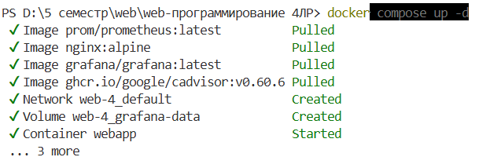
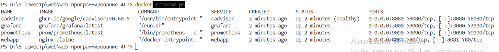
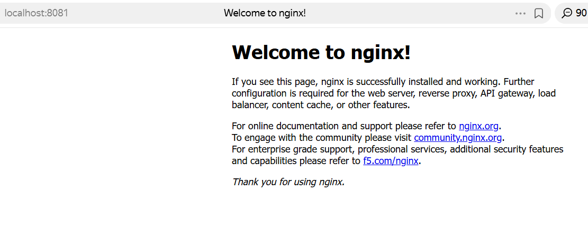
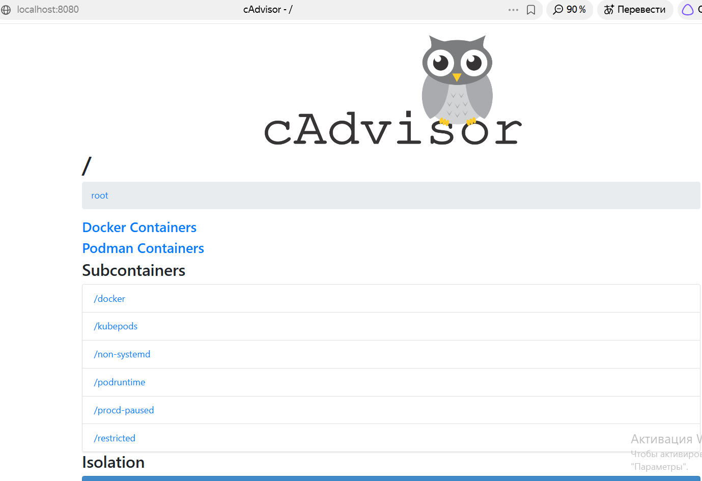
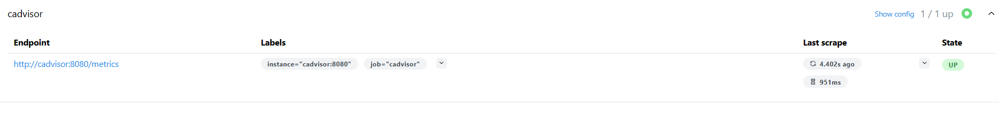
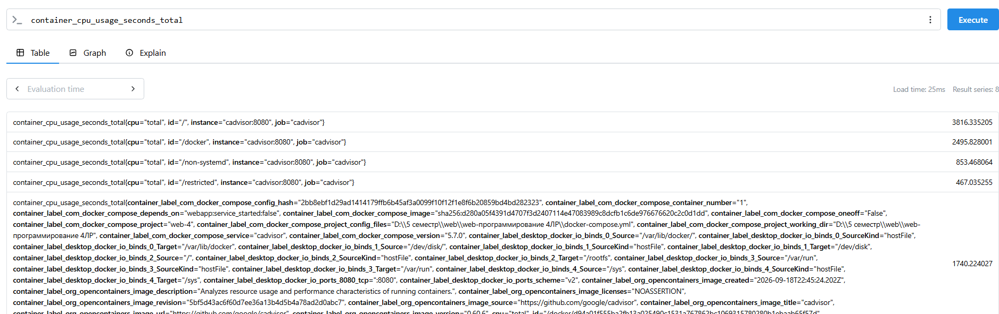
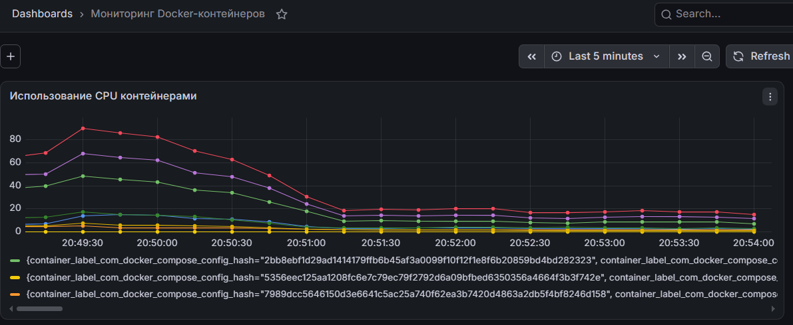

# Лабораторная работа №4

## Тема

Мониторинг Docker-контейнеров с помощью Grafana и Prometheus.

## Цель работы

Развернуть стек мониторинга Docker-контейнеров, включающий тестовое приложение, систему сбора метрик, систему хранения временных рядов и средство визуализации данных.

## Используемые технологии

В работе использовались:

- Docker Desktop;
- Docker Compose;
- nginx;
- cAdvisor;
- Prometheus;
- Grafana;
- WSL 2.

## Схема работы системы

```text
Docker-контейнеры
        ↓
     cAdvisor
        ↓
    Prometheus
        ↓
      Grafana
```

### nginx

Используется в качестве тестового веб-приложения.

### cAdvisor

Собирает информацию о работающих Docker-контейнерах и предоставляет метрики об использовании:

- CPU;
- оперативной памяти;
- сети;
- файловой системы.

### Prometheus

Периодически получает метрики от cAdvisor и хранит их как временные ряды.

### Grafana

Подключается к Prometheus как к источнику данных и отображает метрики в виде графиков.

---

## Структура проекта

```text
web-программирование 4ЛР/
├── docker-compose.yml
└── prometheus.yml
```

---

## Конфигурация Prometheus

Для настройки Prometheus был создан файл `prometheus.yml`.

```yaml
global:
  scrape_interval: 5s

scrape_configs:
  - job_name: "cadvisor"
    scrape_interval: 5s

    static_configs:
      - targets:
          - "cadvisor:8080"
```

Параметр:

```yaml
scrape_interval: 5s
```

задаёт интервал сбора метрик.

Prometheus получает данные от cAdvisor по адресу:

```text
cadvisor:8080
```

Имя `cadvisor` используется вместо `localhost`, так как сервисы работают внутри Docker-сети.

---

## Docker Compose

Для запуска всех необходимых сервисов был создан файл `docker-compose.yml`.

```yaml
services:

  webapp:
    image: nginx:alpine
    container_name: webapp
    ports:
      - "8081:80"

  cadvisor:
    image: ghcr.io/google/cadvisor:v0.60.6
    container_name: cadvisor
    ports:
      - "8080:8080"
    volumes:
      - /:/rootfs:ro
      - /var/run:/var/run:ro
      - /sys:/sys:ro
      - /var/lib/docker/:/var/lib/docker:ro
      - /dev/disk/:/dev/disk:ro
    privileged: true
    depends_on:
      - webapp

  prometheus:
    image: prom/prometheus:latest
    container_name: prometheus
    ports:
      - "9090:9090"
    volumes:
      - ./prometheus.yml:/etc/prometheus/prometheus.yml:ro
    command:
      - "--config.file=/etc/prometheus/prometheus.yml"
    depends_on:
      - cadvisor

  grafana:
    image: grafana/grafana:latest
    container_name: grafana
    ports:
      - "3000:3000"
    volumes:
      - grafana-data:/var/lib/grafana
    depends_on:
      - prometheus

volumes:
  grafana-data:
```

В результате создаются четыре контейнера:

| Контейнер | Назначение | Порт |
|---|---|---:|
| `webapp` | тестовое приложение nginx | 8081 |
| `cadvisor` | сбор метрик контейнеров | 8080 |
| `prometheus` | хранение и обработка метрик | 9090 |
| `grafana` | визуализация метрик | 3000 |

---

## Запуск контейнеров

Перед запуском была выполнена проверка конфигурации:

```bash
docker compose config
```

После проверки стек был запущен командой:

```bash
docker compose up -d
```


Для проверки состояния контейнеров использовалась команда:

```bash
docker compose ps
```


В результате были успешно запущены контейнеры:

```text
cadvisor
grafana
prometheus
webapp
```

## Проверка тестового приложения

В качестве тестового приложения использовался nginx.

В браузере был открыт адрес:

```text
http://localhost:8081
```

В результате появилась стандартная страница:

```text
Welcome to nginx!
```

Это подтверждает, что контейнер nginx работает корректно.

### Скриншот



## Проверка cAdvisor

Веб-интерфейс cAdvisor был открыт по адресу:

```text
http://localhost:8080
```

cAdvisor успешно запустился и получил доступ к информации о контейнерах.

Он используется для сбора метрик использования ресурсов Docker-контейнерами.

### Скриншот




## Проверка Prometheus

Интерфейс Prometheus доступен по адресу:

```text
http://localhost:9090
```

В разделе Target Health был проверен источник данных `cadvisor`.

Его состояние:

```text
UP
```

Endpoint:

```text
http://cadvisor:8080/metrics
```

Это означает, что Prometheus успешно подключился к cAdvisor и получает от него метрики.

### Скриншот



## Проверка метрик

Для проверки получения данных в Prometheus был выполнен запрос:

```promql
container_cpu_usage_seconds_total
```

В результате Prometheus вернул несколько временных рядов с информацией об использовании процессорного времени контейнерами.

Это подтверждает работоспособность цепочки:

```text
Docker → cAdvisor → Prometheus
```

### Скриншот



## Подключение Grafana

Grafana была запущена по адресу:

```text
http://localhost:3000
```

В Grafana был добавлен источник данных Prometheus.

Для подключения использовался адрес:

```text
http://prometheus:9090
```

Использование имени контейнера `prometheus` необходимо, поскольку Grafana и Prometheus работают внутри одной Docker-сети.

После сохранения настроек Grafana успешно выполнила запрос к Prometheus API.

Результат:

```text
Successfully queried the Prometheus API
```

---

## Создание Dashboard

В Grafana был создан Dashboard:

```text
Мониторинг Docker-контейнеров
```

На нём была создана панель:

```text
Использование CPU контейнерами
```

Для построения графика использовался PromQL-запрос:

```promql
rate(container_cpu_usage_seconds_total[1m]) * 100
```

Временной диапазон был установлен:

```text
Last 5 minutes
```

На графике отображается изменение использования CPU работающими контейнерами в реальном времени.

### Скриншот



## Результат работы

В ходе выполнения лабораторной работы был развёрнут стек мониторинга Docker-контейнеров/
Были успешно выполнены следующие действия:

- создано тестовое приложение nginx;
- запущен cAdvisor;
- настроен сбор метрик Prometheus;
- проверен статус cAdvisor `UP`;
- выполнен PromQL-запрос к метрикам контейнеров;
- Prometheus подключён к Grafana;
- создан Dashboard;
- построен график использования CPU контейнерами.

## Вывод

В ходе лабораторной работы был изучен принцип мониторинга Docker-контейнеров.

В результате был создан работающий стек мониторинга, позволяющий отслеживать использование ресурсов Docker-контейнерами в реальном времени.